# Claims Intelligence ML Platform

> A personal, portfolio-grade insurance platform demonstrating production machine-learning engineering, distributed data processing, MLOps, infrastructure as code, site reliability engineering, disaster recovery, model governance, observability, and responsible GenAI on AWS.

## 1. Executive Summary

Claims Intelligence ML Platform is an end-to-end system that helps an insurance operations team prioritize incoming claims. It processes synthetic claim and policy events; builds governed features in Databricks with PySpark; trains and registers a claim-severity model with MLflow; deploys a containerized inference API to Amazon EKS; and continuously monitors service health and model quality.

The platform produces two outputs:

1. **Claim severity prediction:** a supervised model estimates expected claim cost and assigns an operational priority band.
2. **Evidence-grounded claim brief:** an optional large-language-model service summarizes the structured claim record and cites the exact fields used. It does not decide coverage, deny claims, or replace the predictive model.

The project is intentionally designed as a reusable ML platform rather than a single notebook. It includes version-controlled infrastructure, repeatable development/staging/production environments, automated testing, CI/CD, model approval gates, secure credential handling, data-quality checks, drift detection, latency and cost monitoring, rollback procedures, and model documentation.

### Primary portfolio statement

> Built a production-style insurance ML platform using Databricks/PySpark, MLflow, AWS, Docker, Kubernetes, Terraform, GitHub Actions, Prometheus, and Grafana; implemented governed feature pipelines, model-registry promotion, real-time inference, drift monitoring, automated rollback, and evidence-grounded claim summaries.

## 2. Why This Project

This project demonstrates the skills expected from a machine-learning engineer who owns the engineering backbone of ML delivery:

- distributed ETL and feature engineering with Databricks and PySpark;
- model training, evaluation, registry, promotion, and rollback with MLflow;
- repeatable AWS infrastructure provisioned by Terraform;
- containerized inference on Kubernetes using Docker and Amazon EKS;
- automated testing and CI/CD through GitHub Actions;
- secure secrets and workload identity through AWS Secrets Manager, KMS, IAM, and EKS IAM Roles for Service Accounts;
- operational metrics through Prometheus, Grafana, and CloudWatch;
- model-quality, drift, fairness, and cost monitoring;
- clear API and data contracts;
- privacy-by-design, auditability, model cards, and approval controls;
- practical GenAI integration where an LLM is useful, without allowing it to make an insurance decision.

AWS is used in place of Azure. The functional mappings are:

| Enterprise need | AWS implementation |
|---|---|
| Managed Kubernetes | Amazon EKS |
| Container registry | Amazon ECR |
| Object storage/data lake | Amazon S3 |
| Key vault | AWS Secrets Manager and KMS |
| Managed workload identity | EKS IRSA and IAM roles |
| Central logs and alarms | Amazon CloudWatch |
| LLM access | Amazon Bedrock |
| Infrastructure state | S3 backend with DynamoDB locking |
| Managed model lifecycle | Databricks MLflow and Unity Catalog |

## 3. Product Scenario

An insurer receives claim events from multiple channels. Operations staff need a reliable way to identify high-severity claims early, understand the signals behind a prediction, and route the claim for appropriate human review.

The platform ingests synthetic or openly licensed insurance data and constructs features such as:

- policy tenure;
- claim type and reported loss category;
- time between incident and report;
- prior claim count and cumulative prior loss;
- geographic risk aggregates at a coarse, non-identifying level;
- claimant-provided damage indicators;
- event-time and channel characteristics;
- missingness and data-quality indicators.

The model predicts expected claim severity. Business logic converts the prediction into `standard`, `elevated`, or `urgent` review priority. The priority is a workflow aid only. A human remains responsible for any consequential decision.

### Users

- **Claims operations analyst:** requests a score and reviews the explanation.
- **Data scientist:** runs experiments and proposes model versions.
- **ML engineer:** owns pipelines, serving, deployment, monitoring, and rollback.
- **Model risk reviewer:** examines evaluation, fairness, lineage, and approval evidence.
- **Platform operator:** manages infrastructure, access controls, reliability, and cost.

### Explicit non-goals

- deciding whether a claim should be accepted or denied;
- producing legal, financial, or medical advice;
- using real personal or protected insurance data;
- scraping private information;
- auto-promoting a model solely because one aggregate metric improved;
- allowing an LLM to invent claim evidence.

## 4. Success Criteria

The finished project should satisfy the following measurable criteria.

### ML quality

- Baseline model and at least two candidate model families are evaluated.
- Regression metrics include MAE, RMSE, and a business-oriented high-severity recall metric.
- Evaluation is performed on time-based splits to reduce leakage.
- Model performance is reported by important, ethically appropriate slices.
- Every registered model includes its dataset version, code commit, parameters, metrics, and model card.

### Serving reliability

- API p95 latency below 250 ms under the documented local/load-test profile, excluding cold start.
- 99.5% successful-response target in the staging load test.
- Horizontal Pod Autoscaler responds to CPU or request-load signals.
- A failed deployment automatically rolls back.
- The last approved model remains available if the registry or upstream batch job is unavailable.

### Data and model operations

- PySpark jobs are idempotent and partitioned by event date.
- Schema and quality checks fail the pipeline before corrupt data reaches training.
- Drift is measured for input features and prediction distributions.
- Delayed ground-truth performance is calculated when labels become available.
- Alerts contain a runbook link and distinguish service incidents from model-quality warnings.

### Security and governance

- No long-lived AWS credentials are committed or stored in images.
- Pods use least-privilege IAM roles through IRSA.
- Secrets are retrieved at runtime from Secrets Manager.
- S3, ECR, CloudWatch, and registry access are scoped by environment.
- Sensitive fields are excluded from logs and LLM prompts.
- Model promotion requires documented approval evidence.

### Reproducibility

- A new developer can run the local stack from documented commands.
- Terraform can create an isolated development environment.
- Training can be rerun from a tagged dataset and commit.
- Docker images are pinned by immutable digest for deployment.

## 5. System Architecture

```mermaid
flowchart LR
    A[Synthetic/Open Claim Events] --> B[S3 Raw Zone]
    B --> C[Databricks Auto Loader / Batch Ingestion]
    C --> D[Bronze Delta Tables]
    D --> E[PySpark Validation and Transformations]
    E --> F[Silver Delta Tables]
    F --> G[Feature Engineering]
    G --> H[Gold Training and Serving Features]
    H --> I[Databricks Training Job]
    I --> J[MLflow Tracking]
    J --> K[Unity Catalog Model Registry]
    K --> L{Approval Gate}
    L -->|Approved| M[Docker Build]
    M --> N[Amazon ECR]
    N --> O[Amazon EKS Inference Service]
    P[Client / Analyst UI] --> Q[Application Load Balancer]
    Q --> O
    O --> R[Prediction and Audit Logs]
    O --> S[Prometheus Metrics]
    S --> T[Grafana Dashboards]
    R --> U[S3 Monitoring Zone]
    U --> V[Databricks Drift and Performance Jobs]
    V --> S
    O --> W[Optional Bedrock Claim Brief]
    X[CloudWatch Logs and Alarms] --- O
    Y[Secrets Manager + KMS + IAM/IRSA] --- O
    Z[Terraform + GitHub Actions] --> N
    Z --> O
```



### Main request path

1. A client submits a validated claim feature payload.
2. The load balancer forwards the request to the inference service.
3. The service validates the API schema and retrieves the approved model at startup.
4. The service computes or retrieves serving-safe features and returns the prediction, priority band, model version, and explanation fields.
5. Metrics and privacy-filtered audit events are emitted asynchronously.
6. If requested, the separate GenAI service produces a grounded summary from an allowlisted subset of the claim record.

### Main training path

1. Raw data lands in the S3 raw zone.
2. Databricks ingests immutable records into Bronze Delta tables.
3. PySpark creates validated Silver records and quarantines failures.
4. A Gold feature table is constructed with point-in-time-correct joins.
5. A training job logs parameters, data lineage, artifacts, metrics, and slice evaluations to MLflow.
6. A candidate is registered but not automatically promoted.
7. CI and a model-evaluation gate verify the candidate.
8. An approved alias is updated and a pinned serving image is deployed.

## 6. Technology Stack

| Area | Technology | Purpose |
|---|---|---|
| Language | Python 3.12 | Pipelines, model training, API, monitoring jobs |
| Distributed compute | Databricks, PySpark | ETL, feature engineering, batch inference, drift calculations |
| Lakehouse | S3, Delta Lake, Unity Catalog | Versioned data, governance, lineage |
| Modeling | scikit-learn, XGBoost or LightGBM | Baseline and candidate severity models |
| Lifecycle | MLflow | Experiment tracking, artifacts, registry, aliases |
| API | FastAPI, Pydantic | Typed real-time inference contract |
| Containers | Docker | Reproducible training/test/serving environments |
| Orchestration | Amazon EKS, Helm | Scalable Kubernetes deployment |
| Infrastructure | Terraform | Repeatable AWS and Databricks resources |
| CI/CD | GitHub Actions | Tests, images, scans, Terraform plans, promotion |
| Metrics | Prometheus | Service and custom model metrics |
| Dashboards | Grafana | Operational and model-health views |
| Logs/alarms | CloudWatch | Central logs, infrastructure alarms, retention |
| Drift/evaluation | Evidently or custom PySpark metrics | Feature, prediction, and performance monitoring |
| Secrets/security | Secrets Manager, KMS, IAM, IRSA | Runtime secrets and least privilege |
| GenAI | Amazon Bedrock | Evidence-grounded optional summary |
| Testing | pytest, Great Expectations or Deequ, Locust | Unit, data, integration, and load tests |
| Dependency management | uv or Poetry | Locked Python dependencies |

## 7. Repository Structure

```text
claims-intelligence-ml-platform/
├── README.md
├── Makefile
├── pyproject.toml
├── uv.lock
├── .env.example
├── .pre-commit-config.yaml
├── .github/
│   └── workflows/
│       ├── pull-request.yml
│       ├── build-image.yml
│       ├── terraform-plan.yml
│       ├── deploy-dev.yml
│       ├── promote-model.yml
│       └── scheduled-monitoring.yml
├── contracts/
│   ├── claim_event.schema.json
│   ├── prediction_request.schema.json
│   └── prediction_response.schema.json
├── data/
│   ├── README.md
│   ├── sample/
│   └── generators/
├── notebooks/
│   └── exploration_only/
├── src/claims_intelligence/
│   ├── config.py
│   ├── logging.py
│   ├── data/
│   │   ├── ingest.py
│   │   ├── validate.py
│   │   ├── transform.py
│   │   └── feature_pipeline.py
│   ├── training/
│   │   ├── split.py
│   │   ├── train.py
│   │   ├── evaluate.py
│   │   ├── fairness.py
│   │   ├── register.py
│   │   └── model_card.py
│   ├── serving/
│   │   ├── api.py
│   │   ├── schemas.py
│   │   ├── model_loader.py
│   │   ├── predict.py
│   │   └── metrics.py
│   ├── genai/
│   │   ├── brief_service.py
│   │   ├── prompt.py
│   │   ├── grounding.py
│   │   └── safety.py
│   └── monitoring/
│       ├── drift.py
│       ├── performance.py
│       ├── cost.py
│       └── alerts.py
├── databricks/
│   ├── databricks.yml
│   ├── resources/
│   └── jobs/
│       ├── bronze_to_silver.py
│       ├── silver_to_gold.py
│       ├── train_model.py
│       └── monitor_model.py
├── infrastructure/
│   ├── bootstrap/
│   ├── modules/
│   │   ├── network/
│   │   ├── s3_lakehouse/
│   │   ├── ecr/
│   │   ├── eks/
│   │   ├── iam/
│   │   ├── secrets/
│   │   ├── monitoring/
│   │   └── databricks/
│   └── environments/
│       ├── dev/
│       ├── staging/
│       └── prod/
├── deploy/
│   ├── helm/claims-intelligence/
│   ├── grafana/
│   ├── prometheus/
│   └── runbooks/
├── tests/
│   ├── unit/
│   ├── contract/
│   ├── data_quality/
│   ├── integration/
│   ├── model/
│   ├── security/
│   └── load/
└── docs/
    ├── architecture.md
    ├── decisions/
    ├── threat-model.md
    ├── data-dictionary.md
    ├── model-card.md
    ├── incident-response.md
    └── cost-model.md
```

Production code belongs in `src/`, not in notebooks. Notebooks are permitted for exploratory analysis, but the final data and training workflows must be importable, tested Python modules executed as Databricks jobs.

## 8. Data Design

### Safe data choice

Use one of the following:

- a clearly licensed public motor-insurance claim dataset;
- a public severity/frequency dataset with a documented license;
- a completely synthetic dataset generated from documented distributions.

The safest portfolio implementation is synthetic data. It permits intentional drift scenarios and removes ambiguity around personal data.

### Suggested synthetic entities

**Policy**

- `policy_id`: generated opaque identifier;
- `policy_start_date`;
- `coverage_type`;
- `deductible_band`;
- `region_code`: coarse region, not precise location;
- `asset_age_years`;
- `annual_usage_band`.

**Claim event**

- `claim_id`;
- `policy_id`;
- `incident_timestamp`;
- `reported_timestamp`;
- `claim_type`;
- `channel`;
- `initial_estimate`;
- `damage_indicator_count`;
- `weather_category`;
- `narrative`: synthetic text only;
- `final_paid_amount`: delayed training label.

**Derived features**

- policy tenure;
- reporting delay;
- prior claim count over 365 days;
- prior paid amount over 730 days;
- rolling claim frequency by coarse region and claim type;
- missing-value flags;
- categorical encodings;
- safe interaction terms.

### Medallion architecture

**Bronze:** immutable input plus ingestion metadata. Never silently mutate records.

**Silver:** typed, deduplicated, validated data. Invalid records go to a quarantine table with a machine-readable failure reason.

**Gold:** point-in-time-correct training rows and operational aggregate tables. Training and online-serving feature definitions must be aligned.

### Data contracts

Every event contract should declare:

- field name and type;
- nullable status;
- allowed values or range;
- semantic description;
- producer and owner;
- schema version;
- compatibility policy;
- classification such as public, internal, confidential, or prohibited.

Use backward-compatible changes whenever possible. A breaking schema change requires a new contract version and a migration plan.

### Data-quality gates

At minimum, test:

- required-column presence;
- type conformance;
- unique claim identifiers;
- valid timestamps and non-negative reporting delay;
- plausible monetary ranges;
- accepted categorical values;
- referential integrity between claims and policies;
- missingness thresholds;
- row-count changes relative to the recent baseline;
- label leakage checks;
- feature freshness.

## 9. Databricks and PySpark Implementation

### Ingestion

Use Databricks Auto Loader for incremental file discovery if the selected account supports it. A lower-cost alternative is a scheduled PySpark batch that tracks processed object keys in a Delta checkpoint table.

The ingestion job must be idempotent. Reprocessing the same file must not duplicate claims. Record:

- source object path;
- source checksum;
- ingestion timestamp;
- schema version;
- pipeline run ID.

### Feature engineering

Implement transformations with the PySpark DataFrame API. Avoid Python UDFs unless a native Spark expression cannot express the operation. Partition large event tables by a useful low-cardinality date field, compact small files, and document any optimization.

Prevent leakage by joining historical aggregates using the claim's event time rather than the latest available record. A training row for a claim reported on a given date must not use information created after that date.

### Databricks workflows

Create four jobs:

1. `ingest_claims`: raw-to-Bronze ingestion and schema validation.
2. `build_features`: Bronze-to-Silver cleanup and Gold feature construction.
3. `train_severity_model`: time split, model search, evaluation, model card, registration.
4. `monitor_production_model`: drift, delayed performance, fairness slices, and alert emission.

Define jobs with Databricks Asset Bundles or Terraform so they are version controlled. Use job clusters rather than manually maintained interactive clusters where practical.

### Spark evidence to publish

Include screenshots or exported evidence of:

- Spark UI stage/task execution;
- the physical query plan for one important transformation;
- input data size and partition count;
- runtime before and after one justified optimization;
- a discussion of shuffle behavior and small-file management.

This demonstrates actual PySpark competence rather than merely listing it.

## 10. Modeling and MLflow Lifecycle

### Problem formulation

Primary task: regression on `log1p(final_paid_amount)` with predictions transformed back into currency. A secondary operational classification derives whether the claim falls into a high-severity band.

### Candidate models

- median or historical-segment baseline;
- regularized linear model;
- gradient-boosted tree model;
- optional Spark ML baseline for distributed comparison.

A neural network is not necessary unless it adds measurable value. The project should reward sound engineering and evaluation rather than model complexity.

### Evaluation

Use chronological train, validation, and test periods. Report:

- MAE;
- RMSE;
- median absolute error;
- high-severity precision and recall;
- calibration by prediction band;
- error by claim type, channel, region group, and policy-tenure band;
- inference latency and serialized model size.

Document the business trade-off. Missing a genuinely high-severity claim may be more costly than reviewing an extra false positive, so the operational threshold should be selected using a cost matrix rather than accuracy alone.

### MLflow tracking

Every run should log:

- Git commit SHA;
- dataset/table version;
- feature-contract version;
- training window;
- model parameters;
- aggregate and slice metrics;
- feature importance or SHAP summary;
- serialized preprocessing pipeline;
- environment/dependency lock;
- model card;
- evaluator decision.

### Registry lifecycle

Use model aliases such as:

- `candidate`;
- `staging`;
- `champion`;
- `rollback`.

Promotion conditions should include:

- data-quality checks passed;
- no leakage tests failed;
- candidate improves or acceptably trades off target metrics;
- critical slice performance does not regress beyond tolerance;
- security and dependency scans passed;
- load test passed;
- model card complete;
- human approval recorded.

Do not automatically promote based only on validation MAE.

## 11. Real-Time Inference Service

### API contract

`POST /v1/predictions/claim-severity`

Example request:

```json
{
  "claim_id": "clm_demo_1042",
  "policy_tenure_days": 842,
  "claim_type": "collision",
  "reporting_delay_hours": 4.5,
  "initial_estimate": 7200.0,
  "prior_claim_count_365d": 1,
  "damage_indicator_count": 3,
  "region_code": "ON_METRO",
  "channel": "mobile"
}
```

Example response:

```json
{
  "claim_id": "clm_demo_1042",
  "predicted_severity": 8650.25,
  "priority_band": "elevated",
  "model_name": "claims-intelligence-severity",
  "model_version": "17",
  "model_alias": "champion",
  "top_factors": [
    "initial_estimate",
    "damage_indicator_count",
    "claim_type"
  ],
  "prediction_id": "pred_01J..."
}
```

The response must avoid implying certainty. Explanations identify influential model inputs, not causal reasons.

### Required endpoints

- `GET /health/live`: process is alive;
- `GET /health/ready`: model is loaded and dependencies are ready;
- `GET /metrics`: Prometheus metrics;
- `POST /v1/predictions/claim-severity`: versioned prediction endpoint;
- `POST /v1/briefs`: optional grounded GenAI summary endpoint.

### Serving implementation

- Load the approved model once at application startup.
- Validate inputs with Pydantic.
- Keep preprocessing bundled with the registered model.
- Include an idempotency/request identifier.
- Never log full request bodies.
- Emit structured JSON logs.
- Apply request timeouts and payload-size limits.
- Return explicit, stable error codes.
- Support graceful shutdown and Kubernetes probes.
- Pin the deployed model and image version.

## 12. Docker and Kubernetes

### Docker image requirements

- multi-stage build;
- slim, pinned base image;
- non-root runtime user;
- locked dependencies;
- health check;
- no credentials in build arguments or layers;
- vulnerability scan in CI;
- software bill of materials;
- immutable image tag based on Git SHA.

Use separate images only when needed. A compact API image should not contain Databricks training dependencies.

### EKS deployment

Deploy through Helm with:

- `Deployment` with at least two staging replicas for availability testing;
- `Service` and AWS Load Balancer Controller ingress;
- `ConfigMap` for non-secret configuration;
- Secrets Store CSI or runtime Secrets Manager retrieval;
- IRSA service account;
- resource requests and limits;
- liveness, readiness, and startup probes;
- Pod Disruption Budget;
- Horizontal Pod Autoscaler;
- topology spread constraints;
- rolling update configuration;
- NetworkPolicy where supported.

### Release strategy

Use a canary or blue/green release:

1. deploy the candidate alongside the champion;
2. run smoke and contract tests;
3. route a small synthetic test load;
4. compare errors, latency, and prediction sanity checks;
5. increase traffic only if gates pass;
6. roll back automatically if the error budget is exceeded.

## 13. Terraform Infrastructure

### Resources

Terraform should manage:

- VPC, public/private subnets, route tables, NAT strategy, and security groups;
- S3 buckets for raw, curated, monitoring, and Terraform-state data;
- bucket encryption, lifecycle, versioning, and access logging;
- ECR repositories and retention policies;
- EKS cluster, node groups, add-ons, and IAM roles;
- IAM policies and IRSA roles;
- Secrets Manager secrets and KMS keys;
- CloudWatch log groups, retention, dashboards, and alarms;
- Databricks workspace integration, catalog objects, jobs, and permissions where account access permits;
- Prometheus/Grafana integration or Helm releases;
- environment-specific DNS and load-balancer resources.

### Environment separation

Create `dev`, `staging`, and `prod` roots that call reusable modules. They must have separate state and distinct resource names. Production should require stronger approvals and deletion protection.

Do not use one workspace with conditionals for everything. Keep environment intent explicit and reviewable.

### Remote state

- encrypted S3 backend;
- DynamoDB locking if supported by the selected Terraform version/workflow;
- state access restricted to deployment roles;
- no secrets placed directly in state when avoidable;
- state backups and versioning enabled.

### Terraform quality gates

- `terraform fmt -check`;
- `terraform validate`;
- TFLint;
- Checkov or tfsec;
- generated plan attached to pull request;
- manual approval before staging/prod apply;
- drift detection on a schedule.

## 14. CI/CD and Release Management

### Pull-request workflow

Run:

1. formatting and linting;
2. type checking;
3. unit tests;
4. API contract tests;
5. small Spark transformation tests;
6. data-quality tests on fixtures;
7. model-behavior tests;
8. Docker build;
9. dependency and container security scans;
10. Terraform validation and plan.

### Main-branch workflow

1. Build and sign the image.
2. Push it to ECR with the Git SHA.
3. Deploy to development.
4. Run smoke and integration tests.
5. Produce a release artifact containing image digest, model version, test evidence, and Terraform plan.

### Staging and production promotion

- use GitHub environments;
- require approval for staging and production;
- use OIDC federation from GitHub Actions to AWS—no static AWS keys;
- deploy by immutable image digest;
- verify the expected MLflow model version;
- record release metadata;
- automatically roll back on failed health or SLO checks.

## 15. Monitoring and Observability

Separate four categories of observability.

### Service metrics

- request count by endpoint and status;
- request latency histogram;
- in-flight requests;
- exception count;
- pod restarts;
- CPU and memory utilization;
- model-load failures;
- dependency timeouts.

### Model metrics

- prediction distribution;
- priority-band distribution;
- feature missingness;
- feature drift (PSI, Jensen-Shannon distance, or KS test as appropriate);
- prediction drift;
- delayed MAE/RMSE;
- high-severity recall;
- slice performance;
- model version traffic share.

### Data pipeline metrics

- records processed and quarantined;
- schema failures;
- duplicate rate;
- data freshness;
- job duration;
- Spark executor failures/retries;
- feature-table age.

### Cost metrics

- Databricks DBUs by job;
- cluster/runtime cost per training run;
- EKS node and pod utilization;
- inference cost per 1,000 requests;
- Bedrock token count and estimated cost;
- S3 growth;
- NAT and data-transfer costs.

### Grafana dashboards

Create three dashboards:

1. **API Operations:** rate, errors, duration, saturation, deployments.
2. **Model Health:** drift, prediction bands, delayed performance, version comparison.
3. **Pipeline and Cost:** Databricks job health, data quality, freshness, and estimated spend.

### Alert policy

Example alerts:

- page-worthy: sustained 5xx rate, readiness failure, no healthy pods, severe latency regression;
- ticket-worthy: drift threshold exceeded on a critical feature, delayed performance regression, repeated data-quality quarantine spike;
- informational: model candidate registered, monitoring job completed, cost forecast approaching budget.

Every alert should identify its owner, severity, dashboard, model/environment, and runbook.

## 16. Model Drift and Performance Monitoring

### Reference windows

Use the approved training distribution as the stable reference and a rolling production window as the comparison. Store the reference statistics with the model artifact.

### Drift workflow

1. Export privacy-filtered prediction events to S3.
2. Run a scheduled PySpark monitoring job.
3. Validate event quality.
4. Compare feature and prediction distributions.
5. Write results to a Delta monitoring table.
6. Expose aggregate metrics to Prometheus or CloudWatch.
7. Alert only when both magnitude and persistence thresholds are met.

Drift does not automatically mean the model is wrong. It triggers investigation, not automatic retraining.

### Delayed labels

When synthetic final-paid labels arrive, join them by `prediction_id` or claim ID and model version. Calculate performance by prediction date and label-maturity window. Avoid comparing immature recent claims with fully developed historical claims.

### Retraining policy

Retraining may be proposed when:

- sustained material drift is observed;
- delayed performance breaches the agreed threshold;
- a data-contract or product change invalidates assumptions;
- sufficient new labeled data is available.

Retraining produces a candidate. It does not bypass evaluation or approval.

## 17. Responsible AI and Model Governance

### Governance artifacts

- model card;
- dataset/data-sheet summary;
- data lineage;
- feature dictionary;
- intended and prohibited uses;
- evaluation and slice results;
- known limitations;
- approval history;
- change log;
- rollback instructions.

### Fairness approach

Do not introduce protected traits merely to make the project look sophisticated. If a public or synthetic dataset contains a defensible evaluation attribute, use it only for offline disparity analysis and document why. Exclude it from prediction unless there is a legitimate, reviewed reason.

Measure whether error or high-severity recall varies materially across appropriate operational slices. Explain that equal aggregate performance does not prove absence of harm.

### Human oversight

- the model prioritizes review; it does not adjudicate claims;
- analysts can see the model/version and explanation;
- analysts can flag suspicious predictions;
- consequential decisions require human review;
- the audit event records the system recommendation without collecting unnecessary personal data.

## 18. GenAI/LLMOps Component

The LLM service should remain small and disciplined. It converts allowlisted structured claim fields into a concise operations brief.

### Example output

```text
Claim clm_demo_1042 was reported 4.5 hours after a collision event.
The initial estimate is $7,200 and three damage indicators are recorded.
The severity model assigned an elevated review priority.
Evidence: initial_estimate, reporting_delay_hours, damage_indicator_count.
```

### Guardrails

- use only synthetic data;
- allowlist prompt fields;
- redact identifiers unnecessary for the summary;
- require cited field names;
- instruct the model not to decide coverage or liability;
- validate response structure;
- reject unsupported claims by checking cited values against the input;
- log model ID, prompt-template version, latency, token count, and validation result;
- do not log full prompts containing claim text;
- provide a deterministic template fallback.

### LLM evaluation

Build a fixed evaluation set and score:

- factual consistency with structured input;
- citation completeness;
- prohibited-decision rate;
- unsupported-claim rate;
- latency;
- estimated cost;
- fallback rate.

Treat prompt templates like code: version, test, review, and promote them.

## 19. Security Design

### Identity

- GitHub Actions authenticates to AWS through OIDC.
- EKS workloads use IRSA.
- Databricks uses a scoped service principal or workload identity integration.
- Humans use role-based access with short-lived sessions.

### Secrets

- store external tokens and credentials in Secrets Manager;
- encrypt with customer-managed KMS keys where justified;
- rotate secrets;
- mount or retrieve secrets only at runtime;
- prevent secret values from appearing in logs, Terraform outputs, or GitHub artifacts.

### Network

- EKS worker nodes and data services reside in private subnets;
- expose only the necessary load balancer endpoint;
- restrict outbound connectivity where practical;
- use VPC endpoints for S3, ECR, CloudWatch, and Secrets Manager when cost permits;
- apply TLS in transit.

### Supply chain

- pin dependencies;
- scan dependencies and container images;
- generate an SBOM;
- sign images;
- deploy by digest;
- run containers as non-root;
- set read-only filesystems where practical.

### Threats to document

- poisoned or malformed training data;
- feature leakage;
- model artifact tampering;
- unauthorized registry promotion;
- prompt injection through narrative fields;
- sensitive data in logs;
- denial of service against inference;
- compromised CI credentials;
- excessive cloud permissions.

## 20. Testing Strategy

### Unit tests

- feature functions;
- threshold mapping;
- input validation;
- model loading;
- drift calculations;
- prompt-field allowlisting;
- cost calculations.

### Data tests

- schema and constraints;
- duplicate handling;
- quarantine behavior;
- idempotent reprocessing;
- point-in-time correctness;
- small Spark input/output fixtures.

### Model tests

- output is finite and within a defensible range;
- preprocessing is identical between training and serving;
- model beats the documented baseline;
- critical slices meet minimum thresholds;
- serialization round trip preserves predictions;
- fixed golden examples remain within tolerance.

### Contract tests

- request and response schemas;
- backward compatibility;
- error codes;
- health endpoint behavior;
- model/version fields always present.

### Integration tests

- local API loads a test MLflow model;
- request produces an audit event;
- ECR image starts as non-root;
- staging deployment accesses only allowed S3/Secrets Manager resources;
- Databricks job writes expected Delta tables.

### Load and resilience tests

- sustained baseline load;
- burst load;
- large but valid payload;
- pod termination during traffic;
- dependency timeout;
- unavailable candidate model with champion fallback;
- rollback after elevated 5xx or latency.

## 21. Infrastructure Testing and Policy Enforcement

The infrastructure layer must be tested as a product, not treated as a collection of configuration files.

### Static and policy checks

Every infrastructure pull request must run:

- `terraform fmt -check` and `terraform validate`;
- TFLint for provider-specific correctness;
- Checkov or tfsec for security misconfigurations;
- Conftest with Open Policy Agent policies for project-specific rules;
- Helm linting and rendered-manifest validation;
- kubeconform against the target Kubernetes API version;
- Trivy scans for images, filesystems, configuration, and Kubernetes manifests;
- secret scanning with Gitleaks;
- dependency review and a generated software bill of materials.

Example enforced policies:

- S3 buckets cannot be public and must enable encryption and versioning;
- security groups cannot expose administrative ports to the internet;
- EKS workloads must define requests, limits, probes, and non-root security contexts;
- production resources require ownership, environment, data-classification, and cost tags;
- container images must use an immutable digest;
- production applies and model promotions require approval;
- wildcard IAM actions or resources fail unless an explicitly reviewed exception exists.

### Terraform module and integration tests

Use Terraform test files and selected Terratest tests to verify:

- module input validation and safe defaults;
- expected resource naming and tags;
- encrypted S3 buckets reject public access;
- IAM policies grant only required actions;
- EKS workload identity can access its permitted bucket and cannot access a prohibited bucket;
- a disposable development stack can be created, smoke-tested, and destroyed;
- a second `terraform apply` produces no unexpected changes.

Run inexpensive static tests on every pull request. Run real AWS integration tests on a schedule or behind an explicit approval because they create billable resources.

### Configuration and drift management

- Keep environment configuration in reviewed version-controlled files.
- Use scheduled `terraform plan -detailed-exitcode` jobs to detect out-of-band changes.
- Open an issue or alert when drift is detected; do not automatically overwrite unknown changes.
- Record approved emergency console changes and reconcile them into Terraform immediately afterward.
- Test provider and module upgrades in development before promotion.

## 22. GitOps and Environment Promotion

GitHub Actions builds and verifies artifacts; Argo CD reconciles Kubernetes deployment state from a dedicated deployment directory or repository.

### Promotion flow

1. Application CI tests the commit and produces a signed image plus SBOM.
2. The image is pushed to ECR under its Git SHA and immutable digest.
3. CI updates the development Helm values with the digest through a reviewed commit.
4. Argo CD reconciles development and reports health.
5. Smoke, contract, security, and load checks produce a promotion artifact.
6. A pull request promotes the exact digest and model version to staging.
7. Production promotion requires human approval and uses the same tested artifacts.

Do not rebuild an image separately for each environment. Environment-specific configuration is injected at deployment time, while the executable artifact remains identical.

### Argo CD controls

- automatic sync is acceptable in development;
- staging may auto-sync only after its promotion pull request merges;
- production uses controlled sync and a maintenance/release policy;
- prune and self-heal behavior must be documented per environment;
- Argo CD Projects restrict namespaces and target clusters;
- sync waves order service accounts, secrets integration, deployments, and monitoring resources;
- rollback uses a Git revert or a previously approved release, not an unrecorded manual edit.

GitOps is a stretch component if cloud cost or time is constrained. The required baseline remains a fully traceable GitHub Actions deployment with immutable artifacts and auditable approvals.

## 23. Site Reliability Engineering and Failure Lab

The project must show how the system behaves when components fail, not merely when the happy path works.

### Service-level indicators

Track:

- **availability:** proportion of valid prediction requests receiving a successful response;
- **latency:** p50, p95, and p99 request duration;
- **correctness:** responses matching the API contract and containing the expected approved model version;
- **freshness:** age of the latest successful feature and monitoring pipelines;
- **model health:** proportion of predictions with valid features and delayed performance within bounds.

### Initial service-level objectives

For the staged portfolio environment:

- 99.5% successful valid requests over the load-test window;
- 95% of prediction requests complete within 250 ms, excluding cold starts and the optional LLM endpoint;
- 99% of prediction responses identify a valid approved model version;
- feature pipeline completes within its scheduled freshness window;
- critical alerts fire within five minutes of a sustained injected failure.

These are demonstration targets, not claims of real-world production availability. Revisit them after collecting measurements.

### Error budget

Define the allowed failed-request fraction from the availability SLO. When the staged error budget is exhausted:

- stop nonessential releases;
- prioritize reliability defects;
- review recent deployments and capacity signals;
- resume promotion only after the service returns to an acceptable state.

Create a Grafana view showing SLO compliance, remaining error budget, and burn rate.

### Controlled failure experiments

Implement a repeatable `failure-lab` suite using Kubernetes-native actions, Chaos Mesh, or AWS Fault Injection Service where safe and affordable.

| Experiment | Expected behavior | Evidence |
|---|---|---|
| Delete an inference pod during load | Traffic shifts to healthy replicas; replacement becomes ready | Availability and recovery-time graph |
| Drain or terminate a development node | Pods reschedule within the documented target | Kubernetes events and timeline |
| Deploy a broken readiness configuration | Canary never receives production traffic; release fails | Deployment and rollback logs |
| Inject downstream timeout | API returns bounded error/fallback without thread exhaustion | Latency, timeout, and saturation metrics |
| Remove access to an unauthorized S3 path | Request is denied while permitted access continues | IAM test and CloudTrail evidence |
| Make candidate model unavailable | Service retains or restores the pinned champion | Model-loader and health logs |
| Introduce malformed input data | Data is quarantined and training does not run | Databricks run and quality report |
| Exhaust pod memory in development | Pod restarts, alert fires, and root cause is visible | Alert, events, and postmortem |

Use strict environment guards so destructive experiments cannot target production. Each experiment must declare prerequisites, blast radius, abort conditions, cleanup, and expected steady state.

### Incident management evidence

For at least two experiments, produce:

- an alert with actionable context;
- an incident timeline;
- time to detect and time to recover;
- diagnostic commands and dashboard links;
- a blameless postmortem;
- corrective actions and owners;
- proof that a regression test or policy was added.

### Runbooks

Write runbooks for:

- elevated error rate;
- high latency or pod saturation;
- model-loading failure;
- drift or delayed-performance alert;
- failed Databricks pipeline;
- Terraform apply failure;
- credential/secret rotation;
- rollback to a prior application image and model;
- suspected data-quality incident.

## 24. Backup, Restore, and Disaster Recovery

Backups are not complete until a restore has been tested.

### Assets and recovery mechanisms

| Asset | Protection | Restore method |
|---|---|---|
| Terraform state | Versioned encrypted S3 bucket with restricted access | Restore a selected object version and validate with a read-only plan |
| Curated datasets | S3 versioning plus Delta transaction history and retention policy | Restore object/version or Delta table version into an isolated path |
| Model artifacts | MLflow/Unity Catalog plus versioned artifact storage | Reassign approved alias or load the prior registered version |
| Container images | Immutable ECR digests with protected retention | Redeploy the previous approved digest |
| Kubernetes state | Git/Helm as source of truth; optional Velero for cluster objects | Reconcile from Git or restore approved backup |
| Dashboards and alerts | JSON/YAML stored in Git | Reapply through Terraform/Helm/GitOps |
| Secrets | Managed service with documented rotation/recreation process | Rotate or recreate; never place secret values in repository backups |

### Recovery objectives

Use explicit demonstration targets:

- **Inference application RTO:** 30 minutes in the portfolio environment;
- **Inference configuration RPO:** last merged deployment commit;
- **Model RPO:** latest approved registered model;
- **Curated-data RPO:** latest completed Delta transaction or scheduled backup;
- **Terraform-state RPO:** latest versioned state write.

These targets must be presented as chosen project objectives, not contractual production guarantees.

### Required recovery drills

1. Restore a previous Terraform-state version into an isolated validation workflow and run a read-only plan.
2. Roll back both application image and model alias to a known compatible release.
3. Restore or clone a Delta table from a prior version and verify record counts and checksums.
4. Recreate the development Kubernetes deployment from Git and Terraform after deleting the disposable environment.
5. Record actual recovery time, deviations from the runbook, and corrective actions.

### Disaster scenario

Document a regional service disruption without pretending to implement expensive multi-region active-active infrastructure. The design should explain:

- which data is replicated or recoverable;
- how Terraform creates infrastructure in a recovery region;
- how images and model artifacts become available;
- which DNS or client configuration changes are required;
- which services remain unavailable during recovery;
- cost and complexity trade-offs.

For the portfolio implementation, test recovery in a fresh development environment rather than maintaining a continuously running second region.

## 25. Implementation Roadmap

### Phase 0 — Design and contracts

**Deliverables**

- architecture diagram;
- ADRs for core technology decisions;
- synthetic-data specification;
- API and data schemas;
- threat model;
- baseline success metrics.

**Exit criteria**

- no ambiguous label definition;
- no obvious target leakage;
- local development workflow documented.

### Phase 1 — Local vertical slice

**Build**

- synthetic generator;
- local PySpark transformation;
- baseline model and MLflow tracking;
- FastAPI prediction endpoint;
- Docker image;
- Prometheus metrics;
- unit and contract tests.

**Demo**

One command generates data, trains a model, launches the API, returns a prediction, and displays service metrics.

### Phase 2 — Databricks lakehouse

**Build**

- S3-backed Bronze/Silver/Gold Delta tables;
- Databricks jobs;
- data-quality quarantine;
- time-aware feature construction;
- MLflow tracking and registry;
- reproducible training runs.

**Demo**

Show lineage from source object to feature table to registered model.

### Phase 3 — Terraform AWS foundation

**Build**

- remote state bootstrap;
- VPC, S3, ECR, IAM, Secrets Manager, KMS;
- EKS development environment;
- scoped IRSA roles;
- budget and log-retention controls.

**Demo**

A reviewed Terraform plan creates the development environment without manual console configuration.

### Phase 4 — Kubernetes deployment and CI/CD

**Build**

- Helm chart;
- ECR publishing;
- GitHub OIDC;
- automated tests and scans;
- development deployment;
- staging approval gate;
- canary/rollback workflow.

**Demo**

A commit produces a traceable image, deploys to development, passes smoke tests, and exposes the precise model and image versions.

### Phase 5 — Monitoring and governance

**Build**

- Grafana dashboards;
- drift and delayed-performance jobs;
- alert rules and runbooks;
- model card generation;
- approval evidence;
- cost dashboard.

**Demo**

Inject a controlled feature-distribution shift, observe an alert, diagnose it from the dashboard, and document why drift does or does not warrant retraining.

### Phase 6 — Reliability, GitOps, and recovery

**Build**

- infrastructure policy checks and Terratest coverage;
- Argo CD environment reconciliation;
- SLI/SLO and error-budget dashboards;
- controlled failure experiments;
- alert-driven incident runbooks;
- backup, restore, and environment-recreation drills.

**Demo**

Delete an inference pod during load, demonstrate continued service and automated recovery, then show a failed canary rollback and recreate the disposable environment from Terraform and Git. Publish measured detection and recovery times with a short postmortem.

### Phase 7 — Bounded GenAI service

**Build**

- Bedrock integration;
- grounded JSON output;
- evidence validation;
- deterministic fallback;
- prompt/version registry;
- evaluation suite and token-cost monitoring.

**Demo**

Show both a successful grounded brief and a deliberately adversarial narrative that is rejected or safely handled.

### Phase 8 — Portfolio polish

**Deliverables**

- five-minute demo video;
- architecture and operational walkthrough;
- screenshots of MLflow, Databricks, Grafana, GitHub Actions, and Terraform plan;
- performance and cost table;
- incident/rollback demonstration;
- concise resume bullets;
- explicit limitations and future work.

## 26. Minimum Viable and Stretch Scope

### Minimum viable portfolio version

- synthetic dataset;
- PySpark Bronze/Silver/Gold pipeline;
- MLflow tracking and registry;
- one strong tree-based model plus baseline;
- Dockerized FastAPI service;
- Terraform for S3, ECR, IAM, and a small EKS environment;
- GitHub Actions CI;
- Prometheus/Grafana service metrics;
- scheduled drift report;
- model card and runbook.

### Strong final version

- dev/staging/prod separation;
- Databricks Asset Bundles;
- Unity Catalog governance;
- canary deployment and automated rollback;
- delayed-label performance monitoring;
- IRSA and GitHub OIDC;
- cost dashboard;
- bounded Bedrock summary service;
- prompt evaluation and fallback;
- controlled incident demonstration.

### Avoidable scope traps

- building a front end before the platform works;
- adding Kafka when batch ingestion adequately demonstrates the requirement;
- training a complex deep model without a performance reason;
- running an expensive always-on production cluster;
- using real personal data;
- letting notebooks become the production pipeline;
- describing a local demo as production deployment.

## 27. Cost-Control Plan

This project can become expensive if EKS, Databricks, NAT gateways, and Bedrock are left running.

- Set AWS Budgets alerts before provisioning.
- Use small development node groups and scale them to zero or destroy the environment after demos.
- Prefer scheduled Databricks job clusters with auto-termination.
- Use small synthetic datasets during development.
- Apply S3 lifecycle policies.
- Limit log retention in development.
- Avoid unnecessary NAT traffic; evaluate VPC endpoints against their own hourly cost.
- Cap Bedrock requests and use a fixed evaluation set.
- Tag every resource with project, environment, owner, and cost center.
- Include `make destroy-dev-plan` and documented safe teardown steps.

Publish the approximate cost of one training run, one hour of load testing, and 1,000 predictions. Cost awareness is part of production ML engineering.

## 28. Demo Script

### Five-minute version

1. Show the architecture and state the non-goal: the model prioritizes human review, not claim decisions.
2. Trigger or display a Databricks workflow processing synthetic claims into Delta tables.
3. Open the MLflow run and show dataset version, metrics, slice evaluation, and registered model alias.
4. Show a GitHub Actions release tied to a Git commit and ECR image digest.
5. Send an API request and show prediction, model version, and factor fields.
6. Open Grafana and show traffic, latency, errors, prediction distribution, and drift.
7. Introduce controlled drift and show the monitoring workflow and alert.
8. Show the model card, approval gate, and rollback procedure.

### Interview deep-dive questions to prepare

- Why use Databricks instead of only SageMaker or Glue?
- How did you prevent target leakage?
- How is training-serving skew prevented?
- What happens if the model registry is unavailable?
- Why is drift not an automatic retraining trigger?
- How do IRSA and GitHub OIDC reduce credential risk?
- Which Terraform resources are environment-specific?
- How does the canary determine success?
- What metric matters most to claims operations and why?
- How do you distinguish model error from data-pipeline failure?
- How did you verify the LLM summary was grounded?
- What would change with real regulated data?

## 29. Architecture Decision Records

Create short ADRs for at least:

1. AWS rather than Azure for the cloud implementation.
2. Databricks/Delta Lake for distributed data and ML lifecycle.
3. EKS rather than a simpler container service, specifically to demonstrate Kubernetes operations.
4. Batch-first ingestion rather than unnecessary streaming.
5. MLflow aliases and manual approval for promotion.
6. Synthetic data for privacy and controlled drift.
7. Separate deterministic prediction and generative-summary services.
8. Prometheus/Grafana plus CloudWatch rather than one monitoring plane alone.

Each ADR should contain context, decision, alternatives, consequences, and reversal conditions.

## 30. Definition of Done

The project is complete when:

- infrastructure is reproducible from Terraform;
- no manual console step is required except documented account/bootstrap operations;
- Databricks jobs create governed Bronze/Silver/Gold data;
- a training run is reproducible from code and data versions;
- MLflow contains evaluation evidence and an approved model;
- the API runs locally and on EKS from the same immutable image;
- CI/CD tests, scans, deploys, and records release metadata;
- dashboards show service, pipeline, model, and cost health;
- a controlled drift scenario is detected;
- rollback has been demonstrated;
- infrastructure policies and integration tests prevent unsafe changes;
- SLOs and an error budget are measured from real test traffic;
- at least two controlled failure experiments have incident evidence and postmortems;
- Terraform state, model, data, and environment recovery procedures have been tested;
- Kubernetes deployment state is auditable and reconcilable from Git;
- IAM and secrets use short-lived, least-privilege access;
- model and data documentation is complete;
- the GenAI component is grounded, evaluated, and non-decisional;
- the README contains measured results rather than unsupported claims.

## 31. Resume Bullets After Completion

Use only measurements actually produced by the finished system. A truthful template is:

- Built an AWS insurance ML platform using Databricks, PySpark, MLflow, Docker, EKS, and Terraform, processing **[N]** synthetic claim records through validated Bronze/Silver/Gold pipelines and deploying a versioned severity model behind a FastAPI service.
- Implemented GitHub Actions CI/CD with model-quality gates, container scanning, immutable ECR releases, and Kubernetes canary rollback; achieved **[p95 latency]**, **[throughput]**, and **[availability during test]** under a documented load test.
- Developed Prometheus/Grafana and PySpark monitoring for service health, feature drift, delayed model performance, and cloud cost, detecting a controlled distribution shift within **[time]** while preserving model/version lineage in MLflow.
- Provisioned least-privilege AWS infrastructure with Terraform, EKS IRSA, Secrets Manager, KMS, and GitHub OIDC across isolated development and staging environments.
- Defined SLIs, SLOs, and error-budget alerts; used controlled Kubernetes failure experiments to validate automated recovery, canary rollback, and infrastructure restoration within measured recovery targets.
- Added an evidence-grounded Bedrock claim-brief service with schema validation, cited input fields, deterministic fallback, and an evaluation suite measuring factual consistency, latency, and token cost.

## 32. Final Portfolio Checklist

- [ ] Public repository contains no credentials or personal data.
- [ ] Architecture diagram matches the implemented system.
- [ ] Setup instructions work from a clean environment.
- [ ] Data source and license are documented.
- [ ] Synthetic-data assumptions are disclosed.
- [ ] PySpark transformations are tested and productionized outside notebooks.
- [ ] MLflow runs include code and dataset versions.
- [ ] Model card includes limitations and slice performance.
- [ ] Docker image is non-root, scanned, and pinned.
- [ ] Terraform modules and environment plans are reviewable.
- [ ] Terraform integration tests and policy-as-code checks are passing.
- [ ] GitHub Actions uses OIDC, not static AWS keys.
- [ ] GitOps reconciliation and immutable promotion are demonstrated.
- [ ] EKS deployment includes probes, limits, autoscaling, and rollback.
- [ ] Prometheus/Grafana dashboards include service and model health.
- [ ] SLO, error-budget, and burn-rate dashboards use real test measurements.
- [ ] At least two failure experiments include timelines and postmortems.
- [ ] State, model, data, and full-environment recovery drills are documented.
- [ ] Drift demo and incident runbook are documented.
- [ ] Cost estimates and teardown steps are included.
- [ ] GenAI claims are grounded and automatically checked.
- [ ] Demo video shows evidence rather than slides alone.
- [ ] Resume bullets use only verified measurements.

---

## Recommended Build Order

Start with the local vertical slice, then Databricks, then Terraform/AWS, then Kubernetes and CI/CD, and only afterward add advanced monitoring and GenAI. A simple, fully reproducible system with strong evidence is more valuable than a broad architecture whose pieces were never integrated.
