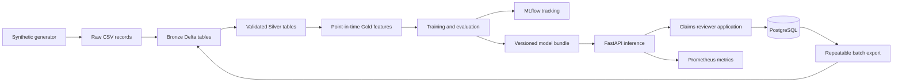

# Architecture

## Local-first system

The initial implementation follows the upper data-to-inference path. The reviewer application, PostgreSQL workflow, identity, and the application-to-lakehouse export are subsequent required releases.

## Prediction path

The inference process loads one approved `ModelBundle` at startup. The bundle contains preprocessing, the fitted estimator, review-priority thresholds, model metadata, and evaluation metrics. A request is schema-validated before the bundle receives exactly the feature fields it was trained on. The response identifies the model version and reports influential inputs as associations, not causal explanations.

## Training path

Synthetic claims and policies are immutable source records. Validation produces typed Silver data and quarantines rejected records. Gold rows use the claim report timestamp as the prediction moment. Historical counts use prior report times; historical paid amounts include only prior claims that had closed by the current prediction moment. Chronological splits keep later claims out of training and validation.

## Trust boundaries

- Browser input is untrusted and must pass frontend and backend validation.
- The inference API never accepts a caller-supplied model path or model version.
- Model artifacts are produced by the training workflow and explicitly approved before activation.
- Application accounts and workload identities are different security subjects.
- Synthetic records are still treated as internal data so the system exercises realistic controls without claiming protection of real insurance data.
